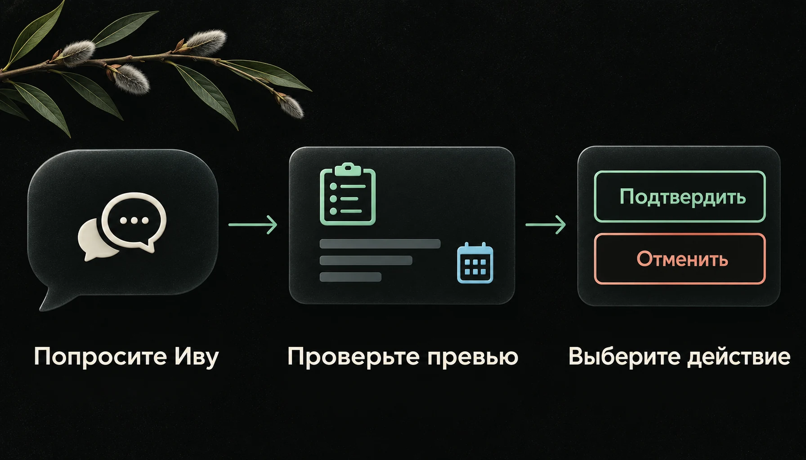
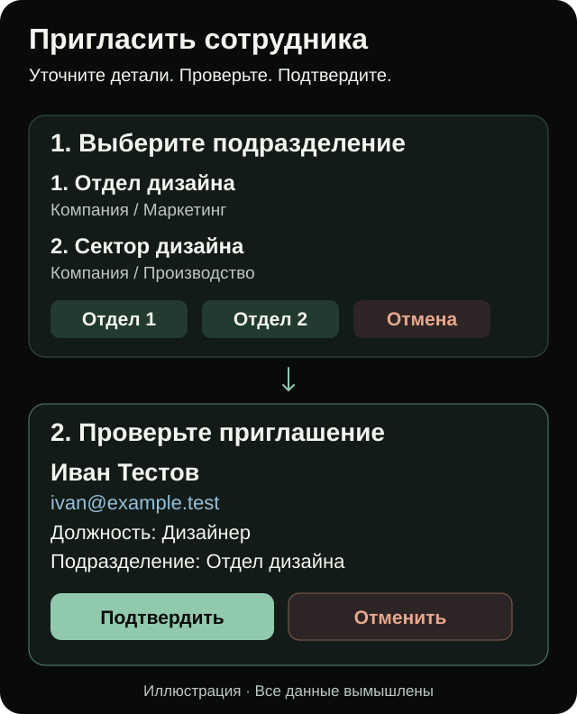

<div align="center">


# Bitrix24 в переписке с Ивой

**Задачи, документы и сотрудники Bitrix24 — в разговоре с Ивой.**

[](https://github.com/mamysh/iva-bitrix24/releases)
[](https://github.com/mamysh/iva-bitrix24/actions/workflows/ci.yml)
[](LICENSE)

[Возможности](#что-попросить-у-ивы) · [Установить](#установить) · [Сотрудники](#сотрудники-через-диалог) · [Настройки](#меню-настроек-битрикс) · [Документация](#документация)

</div>

Найдите нужный документ, разберитесь в обсуждении, поставьте задачу или подготовьте
приглашение или увольнение сотрудника — прямо в Telegram. Плагин подключает ваш Bitrix24 к
[Иве](https://github.com/smixs/iva-agent): вы пишете обычным языком, Ива уточняет детали
и показывает изменения перед подтверждением.

## Установить

Нужны работающая Ива **0.4.0 или новее**, её Linux-сервер и входящий webhook Bitrix24.
На сервере под пользователем Ивы выполните:

```bash
curl -fsSL https://raw.githubusercontent.com/mamysh/iva-bitrix24/main/install.sh | bash
```

Мастер на русском установит плагин, поможет настроить доступ и проверит подключение.
Webhook вводится скрыто на сервере — отправлять его в Telegram не нужно.
[Как получить webhook и выбрать права](docs/SETUP.md#1-подготовьте-bitrix24).

Обычная установка и Marketplace устанавливают **стабильную версию 0.9.0** для задач
и документов. Приглашения, изменение профилей и увольнение сотрудников доступны в кандидате на 1.0
**1.0.0-rc.1** с Panels — [подключить работу с сотрудниками](docs/EMPLOYEES.md#подключить-сценарий).

## Что попросить у Ивы

| Напишите в чате | Что сделает Ива |
| --- | --- |
| «Покажи мои просроченные задачи» | Найдёт доступные задачи с истёкшим сроком. |
| «Почему у этой задачи поменялся срок?» | Посмотрит историю и обсуждение. |
| «Найди презентацию в задачах моего отдела» | Покажет подходящие документы и предложит выбрать. |
| «Разбери документ из этой задачи» | Скачает выбранный файл и поможет с содержимым. |
| «Создай задачу: проверить макет. Описание: сверить текст и цены. Ответственный — Иван Тестов. Срок — 30 октября 2026, 18:00, Минск» | Найдёт сотрудника и подготовит задачу к подтверждению. |
| «Добавь наблюдателя и три пункта чек-листа, напиши в чат “макет готов”» | Соберёт изменения в одно превью. |
| «Перенеси задачу №101 в колонку “Проверка”» | Покажет выбранную стадию проекта. |
| «Удали загруженный мной файл из чата задачи №101» | Покажет файл и запросит подтверждение удаления. |
| «Закрой эту задачу» | Подготовит завершение или принятие результата. |

Если задача или сотрудник определены неоднозначно, Ива попросит уточнение.
Списки и отчёты приходят в чат с таблицами и короткими ссылками на задачи.

## Как меняются задачи



1. **Опишите действие.** Для новой задачи нужны название, описание, ответственный и срок.
   Проект, наблюдателей и чек-лист можно добавить по желанию.
2. **Проверьте превью.** Ива покажет все изменения. Напишите правку, если нужно
   что-то исправить, или отмените действие.
3. **Подтвердите.** Ива выполнит действие и проверит результат в Битриксе.

Несколько изменений одной задачи можно собрать в одно подтверждение. Если один из пунктов
не выполнится, Ива остановится и сообщит, что уже изменилось и что осталось.

<details>
<summary><b>Как работает подтверждение</b></summary>

Превью действует 30 минут. Изменённый черновик требует нового подтверждения.
Перед записью плагин повторно проверяет права и состояние задачи. Если исход запроса
неизвестен, запись не повторяется автоматически.

Для задач ответ на подтверждение передаёт Ива через модель. Плагин фиксирует содержание
черновика, но самостоятельно не удостоверяет нажатие кнопки. Для кадровых действий
подтверждение обрабатывается отдельно через Panels.
[Контракт действий](docs/TASK_WRITES.md) · [Защита данных](SECURITY.md).

</details>

## Сотрудники через диалог

> Добавь Иванова Ивана в дизайн.

Начать можно с одной фразы. Ива найдёт подходящие подразделения, попросит недостающую
почту и сохранит уже сообщённые данные. Если вариантов несколько, названия и пути
появятся нумерованным списком, а кнопки будут короткими: **«Отдел 1»**, **«Отдел 2»**,
**«Отмена»**.



Для приглашения нужны **имя, фамилия, email и подразделение**. Должность можно указать
сразу или добавить позже. Готовая карточка появляется в переписке: проверьте данные
и подтвердите отправку. После выполнения Ива сообщит результат.

Существующий профиль тоже можно изменить:

> Поменяй Ивану Тестову должность на ведущего дизайнера.
>
> Переведи Анну Примерову в отдел дизайна, сохрани остальные данные.

Ива уточнит тёзок и покажет **«было → станет»**. Можно изменить имя, фамилию, email,
должность и подразделения. Выбор сотрудника или отдела сам по себе ничего не меняет.

Для увольнения достаточно описать, кого нужно уволить:

> Уволь Ивана Тестова из отдела дизайна.

Ива уточнит сотрудника и покажет отдельную карточку увольнения. После подтверждения
учётная запись станет неактивной, а история работы сохранится. Передачу задач и
управление интеграциями нужно выполнить отдельно. Увольнение аккаунта, через который
подключён плагин, заблокировано.

Для этого сценария нужны **Bitrix-плагин 1.0.0-rc.1**, **Ива 0.5.7** и
совместимый **[Panels](https://github.com/mamysh/iva-panels)** с карточками чата
(от **0.3.0-rc.2**). Panels показывает карточки с кнопками прямо в чате;
переходить в его меню для подтверждения не требуется.
[Подключение и права](docs/EMPLOYEES.md#подключить-сценарий).

*Иллюстрации показывают сценарии на вымышленных данных; это не скриншоты Telegram.*

## Документы из задач — под рукой

Ива ищет файлы во вложениях, обсуждениях и чек-листах. Выберите один, несколько или все:
она скачает нужное и поможет разобрать содержимое. Поиск внутри документов запускается
по вашей просьбе.

Дополнительные компоненты зависят от того, что вы хотите делать:

| Возможность | Что нужно |
| --- | --- |
| Задачи, поиск документов и настройки Bitrix24 | Этот плагин и работающая Ива |
| Приглашения, профили и увольнение сотрудников | Предварительная версия плагина и совместимый [Panels](docs/EMPLOYEES.md#подключить-сценарий) |
| Получать документы вложением в Telegram | [Плагин доставки файлов](https://github.com/mamysh/iva-file-delivery) |
| Просматривать страницы PDF | `pdftoppm` на сервере |
| Просматривать страницы Word, Excel и презентаций | LibreOffice на сервере |

Мастер установки подскажет, каких программ не хватает.
[Подробнее о документах и программах на сервере](docs/SETUP.md).

## Меню настроек Битрикс

> Покажи настройки Битрикс.

Здесь можно проверить подключение, посмотреть доступные возможности, выбрать
**«Только чтение»** или **«Запись с подтверждением»** и настроить данные сотрудников.
Загрузка файлов, удаление сообщений и управление сотрудниками разрешаются отдельно.

Изменения настроек сначала показываются для подтверждения и сохраняются после
перезапуска и обновления. При установленном Panels настройки доступны также через `/panels`.
[Все настройки и права](docs/SETUP.md#меню-настроек-плагина).

## Первые сообщения после подключения

Начните с двух запросов:

> Проверь подключение и покажи возможности Bitrix24.
>
> Покажи мои открытые задачи.

Для проверки записи создайте тестовую задачу с доступным сотрудником и будущим сроком.
Проверьте превью, подтвердите создание, затем попросите закрыть задачу.

## Обновить плагин

> Проверь обновление плагина Bitrix24.

Ива покажет версии и предложит **«Обновить»**. После подтверждения обновление выполнится
в фоне; Ива может ненадолго перезапуститься. Результат можно запросить в том же чате:

> Как прошло обновление плагина Bitrix24?

Обычная установка следует стабильному каналу. Если версия закреплена за RC или отдельным
коммитом, [смена канала описана в руководстве](docs/SETUP.md#переход-с-rc-на-stable).

## Доступ и ограничения

- Плагин работает от имени пользователя, создавшего webhook, и видит только доступные ему данные.
- Для записи нужны соответствующие права Bitrix24 и разрешение в настройках плагина.
- Восстановление, полное удаление сотрудников и изменение самих подразделений пока не поддерживаются.
  CRM, удаление задач и произвольные команды Bitrix24 также недоступны.
- В чат задачи можно отправить один файл до 50 МиБ; нужен современный чат задачи.
- Webhook хранится на вашем сервере. Не публикуйте его и не отправляйте в Telegram.
  [Подробнее о безопасности и данных](SECURITY.md).

## Документация

[Установка и настройка](docs/SETUP.md) · [Сотрудники](docs/EMPLOYEES.md) ·
[Совместимость](docs/COMPATIBILITY.md) · [История версий](CHANGELOG.md) ·
[Безопасность](SECURITY.md) · [Все руководства](docs/README.md).

## Если нужна помощь

[Подсказки по установке и ошибкам](docs/SETUP.md) ·
[Сообщить о проблеме](https://github.com/mamysh/iva-bitrix24/issues).

Укажите версии Ивы и плагина, код ошибки и шаги на вымышленном примере.
Webhook, реальные документы и полные ответы портала прикладывать не нужно.

<details>
<summary><b>Для разработчиков</b></summary>

[Инструменты](docs/TOOLS.md) · [Устройство](docs/DESIGN.md) ·
[Контракт действий](docs/TASK_WRITES.md) · [Правила участия](CONTRIBUTING.md) ·
[Выпуск версии](docs/RELEASING.md).

```bash
npm ci
npm run check
```

</details>

Независимый плагин для Ивы. Не является официальным продуктом Bitrix24 и не аффилирован с ним.
[MIT](LICENSE) — используйте, изменяйте и устанавливайте на свои серверы.
